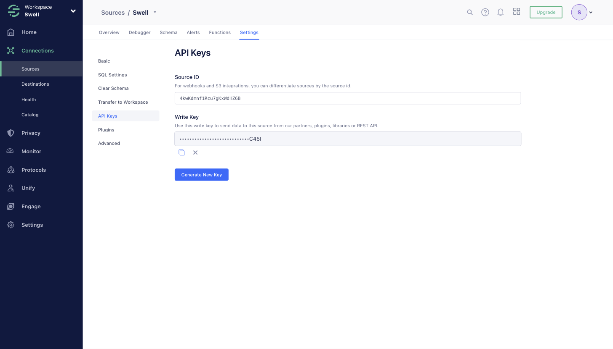
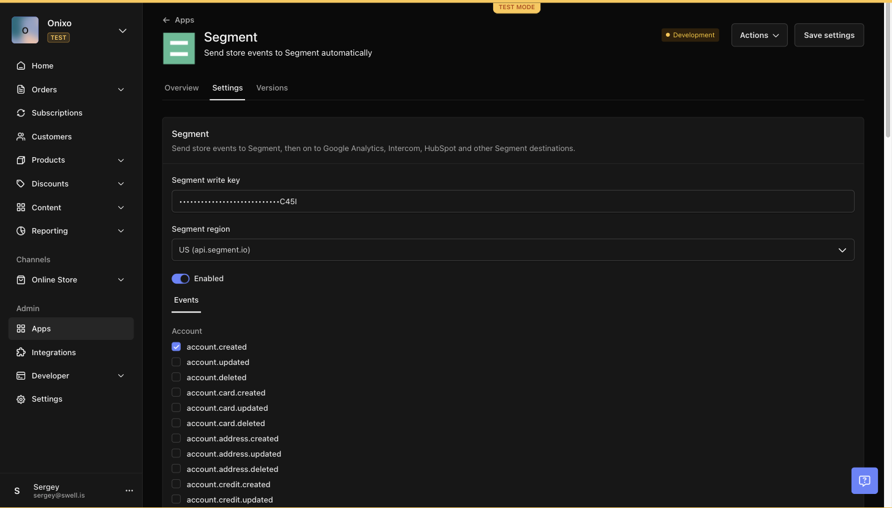
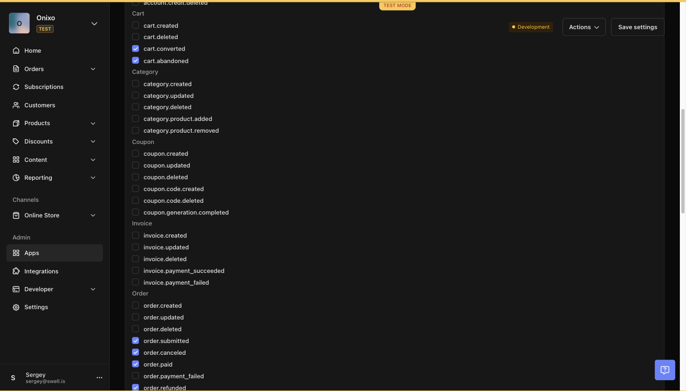
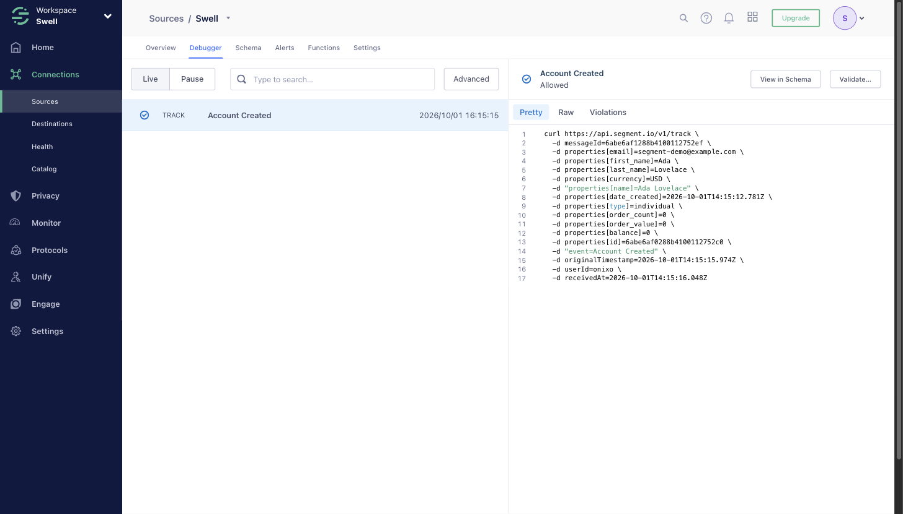

# Segment

Send Swell store events to [Segment](https://segment.com), and from there to Google Analytics, Intercom, HubSpot and [other Segment destinations](https://segment.com/product/connections/).

This app is a port of Swell's built-in Segment integration (Settings → Integrations → Segment) to a Swell App. It keeps the same behavior, so events look the same in Segment after switching.

## Features

- **Event forwarding.** Every store event the merchant selects is sent to the Segment [HTTP Tracking API](https://segment.com/docs/connections/sources/catalog/libraries/server/http-api/) as a `track` call.
- **Readable event names.** The Swell event type is split on `.`, `-` and `_` and capitalized: `cart.converted` → `Cart Converted`, `order.payment_failed` → `Order Payment Failed`, `product.review.created` → `Product Review Created`.
- **Full record as properties.** The event's record (order, cart, account, …) is sent as the event `properties`, without Swell's `$event` metadata.
- **Same user id as the built-in integration.** `userId` is the store id (falls back to the Swell event id).
- **No duplicates on retry.** `messageId` is the Swell event id, so Segment deduplicates if the platform retries an event.
- **US or EU workspaces.** Choose the Segment region in settings.
- **Pause without losing setup.** The *Enabled* toggle stops sending while keeping the write key and event selection.

### Supported events

Each group is a checkbox list in the app settings. Each group is handled by its own function (`functions/track-<group>.ts`).

| Group | Events |
| --- | --- |
| account | `account.created`, `account.updated`, `account.deleted`, `account.card.created/updated/deleted`, `account.address.created/updated/deleted`, `account.credit.created/updated/deleted` |
| cart | `cart.created`, `cart.deleted`, `cart.converted`, `cart.abandoned` |
| category | `category.created`, `category.updated`, `category.deleted`, `category.product.added`, `category.product.removed` |
| coupon | `coupon.created`, `coupon.updated`, `coupon.deleted`, `coupon.code.created`, `coupon.code.deleted`, `coupon.generation.completed` |
| invoice | `invoice.created`, `invoice.updated`, `invoice.deleted`, `invoice.payment_succeeded`, `invoice.payment_failed` |
| order | `order.created`, `order.updated`, `order.deleted`, `order.submitted`, `order.canceled`, `order.paid`, `order.payment_failed`, `order.refunded`, `order.delivered`, `order.trial_started`, `order.trial_will_end`, `order.trial_ended` |
| page | `page.created`, `page.updated`, `page.deleted` |
| payment | `payment.succeeded`, `payment.failed`, `payment.voided`, `payment.refund.succeeded/failed/voided` |
| product | `product.created`, `product.updated`, `product.deleted`, `product.stock_adjusted`, `product.variant.created/updated/deleted`, `product.review.created/updated/deleted` |
| promotion | `promotion.created`, `promotion.updated`, `promotion.deleted` |
| shipment | `shipment.created`, `shipment.updated`, `shipment.deleted`, `shipment.canceled` |
| subscription | `subscription.created`, `subscription.updated`, `subscription.deleted`, `subscription.activated`, `subscription.trial_will_end`, `subscription.trial_ended`, `subscription.invoiced`, `subscription.payment_failed`, `subscription.paid`, `subscription.canceled`, `subscription.paused`, `subscription.resumed`, `subscription.completed` |

This is the built-in integration's event list, minus events that Swell Apps cannot subscribe to.

### Message sent to Segment

```json
POST https://api.segment.io/v1/track
Authorization: Basic base64("<write_key>:")

{
  "userId": "<store id>",
  "event": "Order Paid",
  "properties": { "id": "…", "number": "100123", "grand_total": 42, "...": "full order record" },
  "messageId": "<swell event id>",
  "timestamp": "2026-09-30T14:14:41.244Z",
  "context": { "library": { "name": "swell-app-segment", "version": "1.0.0" } }
}
```

## Settings

All credentials and options are in **Apps → Segment → Settings** (`settings/segment.json`). Nothing is hard-coded.

| Setting | ID | Default | Description |
| --- | --- | --- | --- |
| Segment write key | `write_key` | — | Required. Write key of the Segment source that should receive the events. |
| Segment region | `region` | `us` | `us` → `https://api.segment.io`, `eu` → `https://events.eu1.segmentapis.com`. Must match your Segment workspace region; see [Which region am I in?](#which-region-am-i-in). |
| Enabled | `enabled` | on | Turn off to pause sending. |
| Events → *group* | `events_<group>` | none | Checkbox list per group (see table above). Only checked events are sent. |

Functions read these with `await req.swell.settings()` under the `segment` key.

## Setup

1. In Segment, go to **Connections → Sources → Add Source** and add an **HTTP API** source (or use an existing server-side source).
2. Open the source's **Settings → API Keys** and copy the **Write Key**.

   
3. Install the app in Swell and open **Apps → Segment → Settings**.
4. Paste the write key, pick the region of your Segment workspace (US unless you arranged EU data residency; see below), and keep **Enabled** on.

   
5. Check the events you want to send, then **Save settings**.

   
6. Trigger an event (for example, create a customer or place a test order) and check **Source → Debugger** in Segment.

   

### Which region am I in?

Segment does not show the region anywhere in workspace or source settings. It is the workspace's **Data processing region** (US West or EU West), chosen once when the workspace is created and never changeable afterwards ([Segment: Regional Segment](https://segment.com/docs/guides/regional-segment/)).

- **US is the default.** EU workspaces can only be created after your Segment account executive enables EU data residency for your account. If nobody arranged that, your workspace is US: leave **Segment region** on **US**.
- **Test it.** Send a test event with your write key, then look for it in **Source → Debugger**:

  ```sh
  curl -u '<write_key>:' https://api.segment.io/v1/track \
    -H 'Content-Type: application/json' \
    -d '{"userId":"region-test","event":"Region Test"}'
  ```

  If it is rejected or never shows up, repeat with `https://events.eu1.segmentapis.com/v1/track`; if that one arrives, set **Segment region** to **EU**.
- **Wrong region:** since April 3, 2025 Segment rejects data sent to the other region's endpoint. In this app that shows up in the function logs as `Segment: '<event>' rejected`; the event is not retried.

If you used the built-in Segment integration, turn it off in **Settings → Integrations** after enabling the app, or every event will be sent twice.

## Behavior and limits

- **Nothing is sent until you select events.** Like the built-in integration, the event list starts empty.
- **Missing write key:** events are skipped and a warning is logged (`Segment: write key is not set`).
- **Segment 4xx errors** (bad write key, invalid or oversized payload) are logged and not retried, the same as the built-in integration.
- **Segment 5xx and network errors** make the function fail, so the platform retries the event. Retries reuse the same `messageId`, so Segment does not double count them. Swell auto-disables a model-event function that keeps failing for about 4 days; `swell app push` re-enables it.
- **32 KB message limit.** Segment rejects messages over 32 KB. Very large records (for example orders with many items) can hit this; the app logs a warning with the message size. Segment's 400 response is then logged like any 4xx.
- **One call per event.** The app sends one `track` call per event and does not batch.
- **Every subscribed event runs a function**, even when it is not selected; unselected events return right away without calling Segment.
- **`userId` is the store id**, not a customer id, to stay compatible with the built-in integration. Customer identifiers (`account_id`, `email`, …) are in `properties` when the record has them.
- Functions run on Cloudflare Workers with Swell's default 10 s timeout.

## Project layout

```
swell.json                  App manifest (id: segment, type: integration)
DESCRIPTION.md              Short app description for the listing
assets/icon.png             App icon (placeholder)
assets/screenshots/         Listing screenshots referenced by swell.json "images"
settings/segment.json       Settings: write key, region, enabled, event checkboxes
functions/lib/segment.ts    Shared logic: event list, naming, payload, Segment client, handler
functions/track-<group>.ts  One model-event function per event group, delegating to the shared handler
test/unit/                  Unit tests (mocked fetch and Swell client)
test/integration/           Read-only checks against the logged-in test store
```

To add an event: add it to `EVENT_GROUPS` in `functions/lib/segment.ts`, to the group's `config.model.events` in `functions/track-<group>.ts`, and to the group's checkbox options in `settings/segment.json`. The unit tests fail if these three drift apart.

## Development

Requirements: Node 22+, the [Swell CLI](https://developers.swell.is/cli) logged in to a store (`swell login`).

```sh
npm install
npm run typecheck      # TypeScript for functions and tests
npm test               # all tests (unit + integration)
npx vitest run test/unit          # unit tests only, no store needed
npx vitest run test/integration   # needs `swell login` and a pushed app
```

Deploy to the test environment and check it:

```sh
swell app push
swell inspect functions --app=.
swell inspect settings --app=.
swell logs --type function --app segment
```

Manual end-to-end check: set a write key and select `cart.created` in the app settings, then

```sh
swell api post /carts --body '{"currency":"USD"}'
swell logs --type function --app segment -s track-cart
```

You should see `Segment: tracked 'Cart Created' (cart.created)` and the event in the Segment debugger.

`swell app dev` runs the functions locally against the test environment with console output in your terminal.
